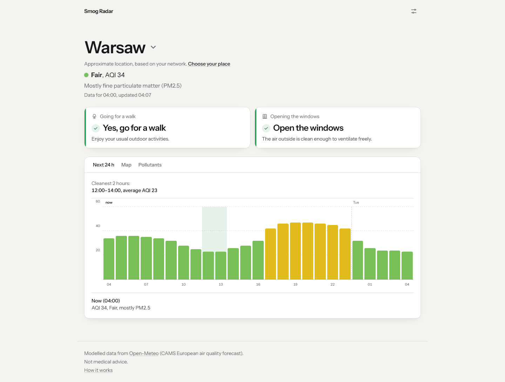

# Smog Radar

Tells you whether the air is good enough for a walk and for opening the windows, and if not, when it will be. Forecast from Open-Meteo (CAMS), station readings from OpenAQ, in English and Polish. How the answers are decided: [docs/methodology.md](docs/methodology.md).



```bash
pnpm install
cp .env.example .env   # optional: OpenAQ API key for the station map
pnpm dev               # http://localhost:3000
```

MIT License.
